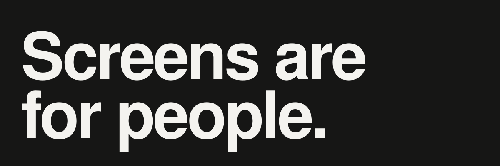
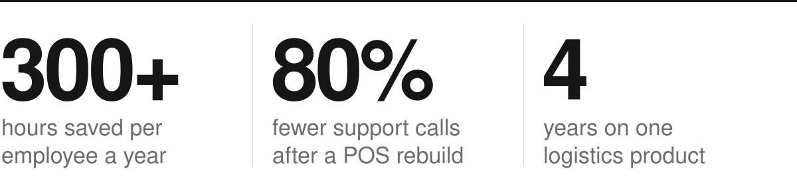

<picture>
  <source media="(prefers-color-scheme: dark)" srcset="assets/hero-dark.svg">
  
</picture>

# Joanna Cieszyńska

**Senior product designer with a computer science degree.** Gdańsk, Poland.

I design the software people keep open all day at work: the dispatcher judging an offer, the cashier at rush hour, the field worker with no signal. In tools like that, every saved second adds up.

[See my portfolio](https://joannacieszynska.com) · [Connect on LinkedIn](https://www.linkedin.com/in/joannacieszynska/) · [Browse my Behance](https://behance.net/joannacieszynska)

<picture>
  <source media="(prefers-color-scheme: dark)" srcset="assets/stats-dark.svg">
  
</picture>

## I read a product from the data model up

I learned how software is built before I designed it for a living. I don’t write code anymore. I still ask what the system stores, where the constraints are, and what the team can ship this quarter.

- **I speak the developers’ language.** Data models, APIs and technical trade-offs don’t scare me, so design decisions get made with the people who build them.
- **I write the handoff developers want to read.** Edge cases, empty states and error copy included. The first build is already the second iteration.
- **I use AI as a daily design tool.** Custom Claude skills take the repetitive parts: handoffs, audits, UX writing, prototypes.
- **I name the number before designing.** If we can’t say what should change, we’re not ready to draw.

## Selected work

| | Project | What changed |
| --- | --- | --- |
| 01 | **TMS ecosystem** Logistics · web and mobile · 2022–now | Replaced the Excel a road-freight desk ran on. **300+ hours saved per employee a year.** |
| 02 | **Client portal** Logistics · web · 2026 | Customers phoned for every status check. Research decided what they should see instead. |
| 03 | **Restaurant point of sale** Hospitality · iPad · 2023–2026 | A 1990s desktop POS rebuilt for touch and right-to-left reading. **Support calls down 80%.** |
| 04 | **AccessTrack** Humanitarian aid · web and offline Android · 2022–2023 | Aid payments handed out where there’s no signal, so the devices verify each other. |

[Read the full case studies](https://joannacieszynska.com)

## Toolbox

**Design:** Figma, design systems, prototyping, UX research, user testing, UX writing, accessibility

**AI:** Claude, custom skills, AI-assisted design and research

## About the repos below

Coursework from my computer science degree, 2020–2021. They stay public because that’s where the “not afraid of technical stuff” part started.
